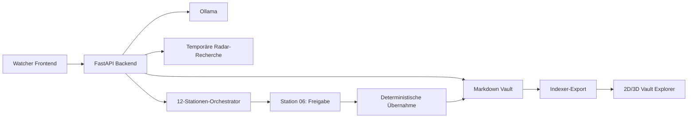

# SecBrain Watcher

SecBrain Watcher ist eine lokale Arbeitsoberfläche für Analyse, Recherche,
Visualisierung und kontrollierte Pflege einer Markdown-Vault. Der Stand vom
24. August 2026 verbindet Dashboard, einen regelgebundenen 12-Stationen-Loop,
Wissensradar, Upload/DokuLader und einen interaktiven 3D-Wissensgraphen.

Der Normalbetrieb ist lesend. Schreibzugriffe sind klar begrenzt:

- Upload und DokuLader schreiben ausschließlich nach `01 Inbox`.
- Der Regelwerk-Editor sichert `AGENTS.md` vor jeder Änderung als Backup.
- Loop und Wissensradar verändern die Vault erst nach ausdrücklicher Freigabe
  an Station 06; danach erfolgen Übernahme, Indexierung, Prüfung,
  Protokollierung und Abschluss-Commit deterministisch.

Der verifizierte Umfang steht in
[CURRENT_BETA_STATUS.md](CURRENT_BETA_STATUS.md). Die frühere R18–R33-Planung
liegt ausschließlich als Historie unter [archive/](archive/README.md).

## Funktionsumfang

- Dashboard mit Vault-, Regel-, Loop- und Konfliktstatus
- lokaler Ollama-Chat mit eigener, vom Loop und Radar getrennter Sitzung
- 12-Stationen-Pflege-Loop mit menschlicher Freigabe an Station 06
- Wissensradar mit Lückenerkennung, kontrollierter Webrecherche,
  KI-Bewertung, Markdown-Diff, Pflegehistorie und Radar-Zeitplan
- Upload von Markdown sowie DokuLader für URLs, PDF- und Dokumentationspakete
- Vault Explorer mit Suche, 2D-Fallback und WebGL-/Three.js-Atlas
- Atlas-Editor für Position und Volumen der Atlasblasen
- Regelwerk-Explorer und gesicherter `AGENTS.md`-Editor

## Sicherheits- und Datenmodell

1. Markdown in der Vault bleibt die Quelle der Wahrheit.
2. Graph und Kennzahlen sind abgeleitete Sichten des Indexer-Exports.
3. KI-Antworten führen nie selbst Dateisystem- oder Git-Aktionen aus.
4. Stationen 01–05 analysieren; Station 06 verlangt eine explizite Freigabe.
5. Freigegebene Änderungen werden gegen Snapshot beziehungsweise Hash geprüft,
   atomar geschrieben, indexiert und als zusammenhängender Lauf committet.
6. Ein produktiver Lauf startet nur bei sauberem Vault-Arbeitsbaum; neue oder
   geänderte Inbox-Dateien sind die einzige zulässige Vorbedingung.
7. Radar-Recherche bleibt bis zur Freigabe außerhalb der Vault unter
   `/tmp/secbrain-watcher/research`.

## Architektur



| Bereich | Dateien |
| --- | --- |
| HTTP/API | `dashboard/backend/dashboard_api.py` |
| Laufzeit und Ollama | `dashboard/backend/runtime_manager.py`, `ollama_client.py` |
| 12-Stationen-Loop | `dashboard/backend/loop/` |
| Wissensradar | `dashboard/backend/knowledge_*_service.py` |
| Upload/DokuLader | `dashboard/backend/dokulader_service.py` |
| Frontend | `dashboard/frontend/` |
| 3D-Einstieg | `dashboard/frontend/assets/vault-graph-3d.js` |
| Graphdaten und Szene | `vault-graph-data.js`, `vault-graph-scene.js` |
| Atlas und Editor | `vault-graph-atlas.js`, `vault-graph-atlas-editor.js` |
| Interaktion und Effekte | `vault-graph-interactions.js`, `vault-graph-effects.js` |

## HTTP-API

Im NAS-Compose-Deployment erfordern Oberfläche und alle API-Routen HTTP-Basic-
Anmeldung. Nur `/healthz` ist für den Container-Healthcheck öffentlich.

| Methode | Route | Zweck |
| --- | --- | --- |
| GET | `/api/status` | Vault- und Laufzeitstatus |
| GET | `/healthz` | inhaltsarmer Healthcheck ohne Anmeldung |
| GET | `/api/vault/graph` | abgeleitete Graphdaten |
| GET/PUT | `/api/vault/agents-md` | Regelwerk lesen/gesichert schreiben |
| POST | `/api/vault/inbox/upload` | Markdown in die Inbox laden |
| POST | `/api/dokulader/urls` | URL-Dokumentation übernehmen |
| POST | `/api/dokulader/package` | Doku-Paket übernehmen |
| POST | `/api/dokulader/pdf` | PDF kontrolliert konvertieren |
| GET | `/api/ollama/status` | Ollama- und Modellstatus |
| GET/POST | `/api/ollama/config` | lokale Modellkonfiguration |
| POST | `/api/ollama/chat` | unabhängige Chat-Sitzung |
| GET | `/api/vault/retrieval/status` | gemeinsame read-only QMD-Retrieval-Schicht prüfen |
| GET | `/api/stations/{station_id}/guardian-rule` | Stationsregel |
| GET | `/api/watcher-loop/status` | Loopstatus und Ergebnisse |
| POST | `/api/watcher-loop/autonomous/start` | Lauf starten |
| POST | `/api/watcher-loop/autonomous/stop` | Lauf anhalten |
| POST | `/api/watcher-loop/autonomous/approve` | Station 06 freigeben |
| POST | `/api/watcher-loop/autonomous/reject` | Vorschlag ablehnen |
| GET | `/api/knowledge-radar` | Wissenslücken analysieren |
| POST | `/api/knowledge-radar/research` | kontrolliert recherchieren |
| POST | `/api/knowledge-radar/ai-evaluate` | lokale KI-Bewertung |
| POST | `/api/knowledge-radar/proposal` | Einpflegevorschlag erzeugen |
| POST | `/api/knowledge-radar/handoff` | an Station 06 übergeben |
| GET | `/api/knowledge-radar/researched` | recherchierte Pflegethemen |
| GET | `/api/knowledge-radar/growth` | Zeitplan und Historie |
| PUT | `/api/knowledge-radar/growth/config` | Zeitplan/Budget speichern |
| POST | `/api/knowledge-radar/growth/run` | Radar-Lauf starten |

## Lokaler Start und Prüfung

```bash
cp .env.example .env
python3 -m venv .venv
.venv/bin/python -m pip install -r requirements-dev.txt
./scripts/start-secbrain-watcher.sh
```

Danach: `http://127.0.0.1:8080`.

```bash
.venv/bin/python -m pytest -q
find dashboard/frontend -name '*.js' -print0 | xargs -0 -n1 node --check
```

## Bekannte Beta-Grenzen

- Browserbasierte End-to-End-Tests für Loop, Radar, Upload und 3D-Graph fehlen.
- Aktive Loop-Zustände leben pro Serverprozess; Radar-Zeitplan und Historie
  liegen unter `~/.local/state/secbrain-watcher/knowledge-radar`.
- Die Abhängigkeiten sollen aus einer frischen `.venv` reproduzierbar
  verifiziert und anschließend enger versioniert werden.
- Backend-Routen, Atlas-Modul und CSS bieten noch weitere Trennstellen.
